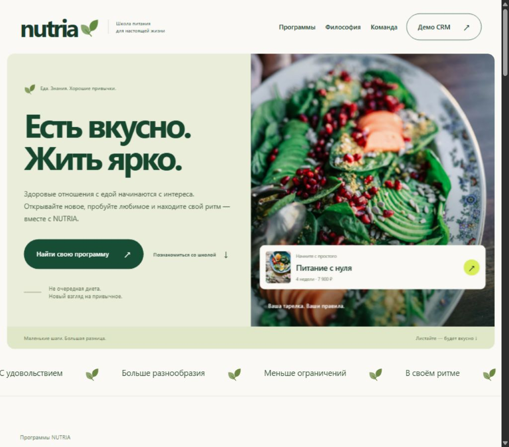

# NUTRIA

Онлайн-школа питания с интерактивной CRM для портфолио: каталог четырёх курсов с индивидуальными программами, оформление заявок, канбан, клиенты, задачи, аналитика и управление доступом сотрудников.

Локальный демонстрационный сайт онлайн-школы питания и CRM. Нужен Node.js 24 или новее; внешние зависимости отсутствуют.

## Запуск

Откройте терминал в этой папке и выполните `npm start` (или `node server.mjs`). Адрес: http://127.0.0.1:4173.

Проверки сервера: `npm test` или `node --test test.mjs`.

## Демо-доступ

На сайте нажмите «Демо CRM» и выберите роль. Для обычного входа:

| Роль | Email | Пароль |
|---|---|---|
| Администратор | admin@example.com | NutriaDemo2026! |
| Менеджер всех заказов | manager@example.com | NutriaDemo2026! |
| Менеджер своих заказов | limited@example.com | NutriaDemo2026! |

Профили и данные вымышлены. Сотрудников создаёт администратор. Новым сотрудникам требуется смена временного пароля.

## Данные и ограничения

SQLite находится в игнорируемой папке `data/`. Каждому браузерному профилю выделяется отдельное пространство по HttpOnly cookie; вкладки одного профиля используют общее пространство. Очистка cookie создаёт новое демо. Сессии действуют сутки; пространства очищаются через семь дней без сохранений. Сброс доступен администратору и затрагивает только его пространство.

Оплата имитируется. Учебной платформы, настоящих писем, телефонии, банковских платежей и интеграций нет. Фотографии загружаются с Unsplash, поэтому для их отображения нужен интернет. Изображения служат иллюстрациями, а не фотографиями реальных преподавателей школы.

Сервер по умолчанию слушает только локальный адрес. Для внешней публикации потребуются отдельная конфигурация HTTPS и cookies, ограничение создания демо по IP, резервные копии и независимая проверка безопасности. Публикация не выполнялась.

## Сценарий демонстрации

1. Выберите курс, нажмите «Купить курс», заполните вымышленные контакты.
2. Создайте заказ и попробуйте имитацию оплаты.
3. Откройте CRM как администратор, найдите заказ по email.
4. Измените этап, сумму, ответственного, оставьте комментарий и создайте задачу.
5. Посмотрите аналитику, затем войдите как ограниченный менеджер для проверки своей области видимости.
